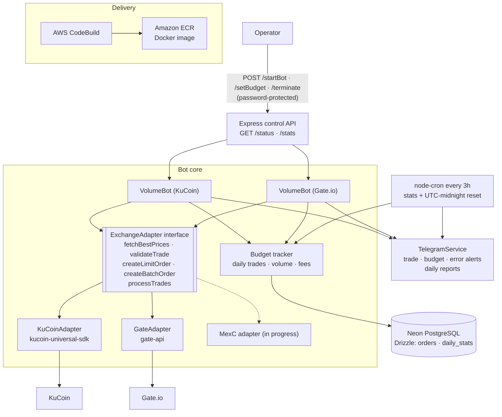

# Volume Bot with Telegram Integration

A multi-exchange trading bot with real-time Telegram notifications for monitoring trading activities, budget alerts, and system status updates.

## 🚀 Features

- **Multi-Exchange Support**: KuCoin, Gate.io, and MexC (extensible)
- **Real-time Telegram Notifications**: Get instant alerts for all trading activities
- **Budget Management**: Automated budget tracking with alerts
- **Daily Statistics**: Automated daily reports sent to Telegram
- **Error Handling**: Comprehensive error notifications
- **Market Data Monitoring**: Real-time price and spread updates

## 📱 Telegram Notifications

The bot sends various types of notifications to your Telegram channel:

### 🔔 Alert Types

1. **Bot Status Alerts**
   - Bot startup/shutdown
   - Exchange connection status
   - System health checks

2. **Trading Alerts**
   - Trade execution confirmations
   - Order placement status
   - Trade validation results

3. **Budget Alerts**
   - Daily/monthly limit warnings
   - Budget threshold notifications
   - Spending summaries

4. **Error Alerts**
   - API connection failures
   - Order placement errors
   - Validation failures

5. **Market Data**
   - Real-time price updates
   - Spread monitoring
   - Market status changes

6. **Daily Reports**
   - End-of-day statistics
   - Trading volume summaries
   - Fee calculations

## 🏗️ Architecture



The ASCII sketch below is the original high-level view:


```
┌─────────────────┐    ┌──────────────────┐    ┌─────────────────┐
│   VolumeBot     │───▶│  ExchangeAdapter │───▶│   Exchange      │
│                 │    │                  │    │   (KuCoin/etc)  │
└─────────────────┘    └──────────────────┘    └─────────────────┘
         │
         ▼
┌─────────────────┐
│ TelegramService │
│                 │
└─────────────────┘
```

## 🛠️ Setup

### 1. Environment Variables

Create a `.env` file with the following variables:

```env
# Telegram Configuration
TELEGRAM_BOT_KEY=your_telegram_bot_token
TELEGRAM_CHAT_ID=your_chat_id

# Exchange API Keys (for each exchange you want to use)
KUCOIN_API_KEY=your_kucoin_api_key
KUCOIN_SECRET=your_kucoin_secret
KUCOIN_PASSPHRASE=your_kucoin_passphrase

# Database Configuration
DATABASE_URL=your_database_url
```

### 2. Install Dependencies

```bash
npm install
```

### 3. Run the Bot

```bash
# Development
npm run dev

# Production
npm start
```

## 📊 API Endpoints

The bot provides REST API endpoints for control and monitoring:

### Bot Control
- `GET /` - Health check
- `POST /start-bot` - Start the volume bot
- `POST /terminate` - Terminate the bot
- `POST /test-telegram` - Send test Telegram message

### Example Usage

```bash
# Start the bot
curl -X POST http://localhost:3000/start-bot

# Send test message
curl -X POST http://localhost:3000/test-telegram

# Check health
curl http://localhost:3000/
```

## 🔧 Exchange Integration

### KuCoin (Fully Implemented)

The KuCoin integration includes:
- Real-time order book monitoring
- Batch order placement
- Trade validation
- Budget tracking
- Comprehensive Telegram notifications

### Gate.io & MexC (Template Ready)

Template implementations are provided for:
- Basic adapter structure
- Telegram integration hooks
- Error handling patterns

To implement a new exchange:

1. Extend the `ExchangeAdapter` interface
2. Implement all required methods
3. Add Telegram notifications at key points
4. Register in `ExchangeFactory`

## 📱 Telegram Message Examples

### Bot Startup
```
🚀 Volume Bot is starting up!
📊 Bot initialized with 24 trade pairs scheduled
🔄 KuCoin: Starting to process 24 trade pairs
```

### Trade Execution
```
✅ KuCoin: Trade validation passed - Size: 100 LOGX, Price: $0.15
📤 KuCoin: Placing 2 batch orders...
🎯 KuCoin: Successfully placed batch orders - 100 LOGX @ $0.15
```

### Daily Report
```
📊 Daily Stats Report

📈 Total Trades: 48
💰 Total Volume: $720.00
💸 Total Fees: $0.43

Keep staking on yourself! 🚀
```

### Budget Alert
```
💰 Budget Alert

📅 Daily Limit: $16.67
📊 Daily Spent: $15.50
📈 Daily Trades: 45

🗓 Monthly Limit: $500.00
💸 Monthly Spent: $450.00
📊 Monthly Trades: 1200

⚠️ Budget limits reached - trading paused
```

## 🔍 Monitoring & Debugging

### Log Levels

The bot uses different log levels for different types of information:
- `INFO`: General bot operations
- `WARN`: Non-critical issues
- `ERROR`: Critical errors with Telegram notifications

### Telegram Debugging

Use the `/test-telegram` endpoint to verify your Telegram configuration:

```bash
curl -X POST http://localhost:3000/test-telegram
```

### Common Issues

1. **Telegram not receiving messages**
   - Check `TELEGRAM_BOT_KEY` and `TELEGRAM_CHAT_ID`
   - Ensure bot has permission to send messages
   - Verify chat ID format

2. **Exchange connection issues**
   - Verify API keys and permissions
   - Check network connectivity
   - Review exchange-specific error messages

## 🚀 Deployment

### Docker

```bash
# Build image
docker build -t volume-bot .

# Run container
docker run -d \
  --name volume-bot \
  --env-file .env \
  -p 3000:3000 \
  volume-bot
```

### Environment-Specific Configs

Create environment-specific configuration files:
- `.env.development`
- `.env.production`
- `.env.staging`

## 🔒 Security Considerations

1. **API Key Management**
   - Use environment variables
   - Rotate keys regularly
   - Limit API permissions

2. **Telegram Security**
   - Use private channels
   - Restrict bot access
   - Monitor message logs

3. **Network Security**
   - Use HTTPS in production
   - Implement rate limiting
   - Monitor API usage

## 📈 Performance Optimization

1. **Telegram Rate Limiting**
   - Batch notifications when possible
   - Implement message queuing
   - Use different chat IDs for different alert types

2. **Exchange API Optimization**
   - Implement connection pooling
   - Use WebSocket when available
   - Cache market data

## 🤝 Contributing

1. Fork the repository
2. Create a feature branch
3. Implement your changes
4. Add Telegram notifications for new features
5. Submit a pull request

## 📄 License

This project is licensed under the MIT License - see the LICENSE file for details.

## 🆘 Support

For support and questions:
1. Check the logs for error messages
2. Verify your Telegram configuration
3. Test with the `/test-telegram` endpoint
4. Review exchange API documentation

---

**Happy Trading! 🚀📈**
